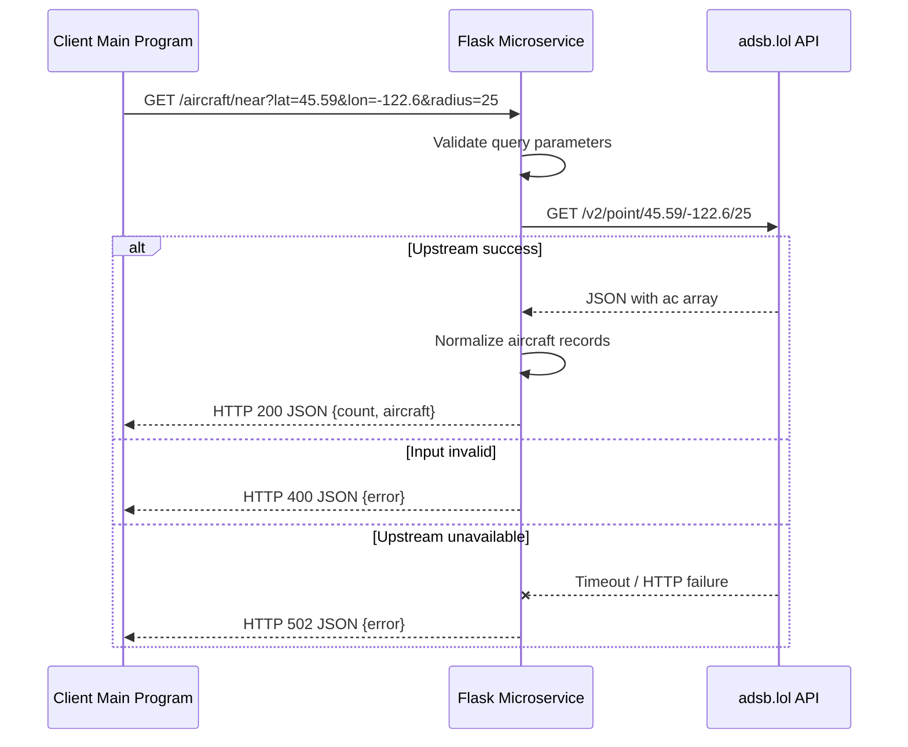

# Flight-Tracker-Microservice

A Python microservice for CS 361 that looks up live aircraft data from the free
[adsb.lol](https://api.adsb.lol) API and returns it in a simple, consistent JSON format.

## Status

🚧 **In progress.** The code that fetches data from adsb.lol works. The Flask HTTP layer that
exposes it as a microservice has not been built yet.

## What's done

### `sources/adsb.py` — adsb.lol client

| Function | What it does |
|---|---|
| `aircraft_near(lat, lon, radius)` | Returns a list of all aircraft within `radius` nautical miles of a point. The radius is converted to an int because adsb.lol rejects decimal values. |
| `aircraft_by_callsign(callsign)` | Returns the first aircraft matching a callsign (e.g. `UAL123`), or `None` if none is found. |
| `normalize_response(response)` | Converts one raw adsb.lol aircraft record into the format below. |

Both lookup functions use a 5-second timeout and call `raise_for_status()`, so HTTP errors
(404, 500, etc.) and network errors are raised as `requests.exceptions.RequestException`.
**The caller is responsible for catching them.**

### Normalized aircraft format

```json
{
  "callsign": "UAL123",
  "altitude_ft": 35000,
  "on_ground": false,
  "latitude": 45.59,
  "longitude": -122.6,
  "speed_kts": 450.2,
  "heading": 270.5,
  "vertical_speed": -64,
  "aircraft_type": "B738",
  "distance_nm": 3.2
}
```

Notes on normalization:
- `callsign` has its whitespace trimmed and is `null` if missing.
- adsb.lol reports altitude as `"ground"` for aircraft on the ground. In that case
  `on_ground` is `true` and `altitude_ft` is `null`.
- Any field the API doesn't provide is `null`.
- `distance_nm` is only filled in for location (`aircraft_near`) searches.

## Setup

Requires Python 3.10+.

```bash
python -m venv .venv
source .venv/bin/activate        # Windows: .venv\Scripts\activate
pip install -r requirements.txt
```

Quick test from the project root:

```bash
python -c "from sources.adsb import aircraft_near; print(aircraft_near(45.59, -122.6, 25))"
```

## To do

### Core
- [ ] Create `app.py` with a Flask app
- [ ] Add endpoints (proposed):
  - `GET /aircraft/near?lat=<lat>&lon=<lon>&radius=<nm>` → list of aircraft
  - `GET /aircraft/callsign/<callsign>` → single aircraft, or 404 if not found
  - `GET /health` → `{"status": "ok"}`
- [ ] Validate input (lat −90 to 90, lon −180 to 180, radius must be positive with a sensible
      maximum) and return `400` with an error message for bad input
- [ ] Catch `requests.exceptions.RequestException` in the routes and return a JSON error
      (e.g. `502 Bad Gateway` if adsb.lol fails or times out)
- [ ] Use one JSON error format everywhere, e.g. `{"error": "message"}`

### Cleanup
- [ ] Fix the "callsigh" typo in the `aircraft_by_callsign` docstring
- [ ] Decide whether `aircraft_by_callsign` should return all matches instead of only the first
- [ ] Make callsign lookups case-insensitive (uppercase the input)

### Testing & docs
- [ ] Add tests (e.g. `pytest`) for `normalize_response`, including on-ground aircraft and
      missing fields
- [ ] Add route tests that mock the adsb.lol calls
- [ ] Write the communication contract: how to request data and what comes back, with example
      requests and responses (required for the CS 361 microservice deliverable)
- [ ] Add a UML sequence diagram showing the main program → microservice → adsb.lol flow

## Project structure

```
Flight-Tracker-Microservice/
├── sources/
│   ├── __init__.py
│   └── adsb.py          # adsb.lol API client + normalization
├── requirements.txt     # Flask, requests
├── .gitignore
└── README.md
```
## UML diagram 
 
sequenceDiagram
    participant Client as Test Client
    participant Flask as Flight Tracker Microservice
    participant API as adsb.lol

    Client->>Flask: GET /aircraft/near
    Flask->>Flask: Validate parameters
    Flask->>API: Request aircraft data
    API-->>Flask: Return aircraft JSON
    Flask->>Flask: Normalize aircraft data
    Flask-->>Client: Return normalized JSON


## Data source

Aircraft data comes from [adsb.lol](https://github.com/adsblol), a free and open ADS-B
aggregator. No API key is required.


## Communication Contract

## Purpose
An HTTP/JSON microservice for **current ADS-B aircraft positions**, backed by adsb.lol. This is not an airline booking or scheduled-flight API. It does not provide guaranteed arrival times, departure schedules, gates, or cancellation statuses.

## Start the service
Python 3.10+ is required.

```bash
python3 -m venv .venv
source .venv/bin/activate
pip install -r requirements.txt
python app.py
```

Server: `http://127.0.0.1:5002` 

## Request and response contract

### 1. Health check
**Request** `GET /health`

**Success 200**
```json
{"status": "ok"}
```

### 2. Aircraft near a location
**Request** `GET /aircraft/near?lat=45.59&lon=-122.6&radius=25`

Required query parameters:
- `lat` — numeric latitude, inclusive -90 to 90.
- `lon` — numeric longitude, inclusive -180 to 180.
- `radius` — whole number of nautical miles, inclusive 1 to 100.

**Success 200** (illustrative data, not live)
```json
{
  "count": 1,
  "aircraft": [
    {
      "callsign": "UAL123", "altitude_ft": 35000, "on_ground": false,
      "latitude": 45.59, "longitude": -122.6, "speed_kts": 450.2,
      "heading": 270.5, "vertical_speed": -64,
      "aircraft_type": "B738", "distance_nm": 3.2
    }
  ]
}
```

The `aircraft` array can be empty.

### 3. Aircraft by callsign
**Request** `GET /aircraft/callsign/ual123`

Required path parameter:
- `callsign` — 2–12 ASCII letters/digits; case-insensitive.

**Success 200** returns a single normalized aircraft object in the same field format above. For callsign searches `distance_nm` is generally `null`. If multiple aircraft match, the service currently returns the first one reported by adsb.lol (not necessarily an exact or unique scheduled flight).

**No match 404**
```json
{"error": "Aircraft not found"}
```

### Error format
All API errors have `{"error": "human-readable message"}`. Status codes:
- `400` malformed, missing or out-of-range input.
- `404` no aircraft found, or unknown route.
- `502` upstream adsb.lol request failed, timed out, or returned invalid data.

## How another application requests and receives data
Run the microservice in one terminal; run this **separate client program** in another:

```bash
python test_client.py
```

Or call from another program:

```python
import requests

response = requests.get(
    "http://127.0.0.1:5002/aircraft/near",
    params={"lat": 45.59, "lon": -122.6, "radius": 25},
    timeout=10,
)
response.raise_for_status()
result = response.json()
for aircraft in result["aircraft"]:
    print(aircraft["callsign"], aircraft["altitude_ft"])
```

JSON responses are parsed via `response.json()`. Check the response status before assuming success.

## Sequence diagram


The microservice and the client program run as **separate processes**, and exchange data via HTTP requests and JSON responses.